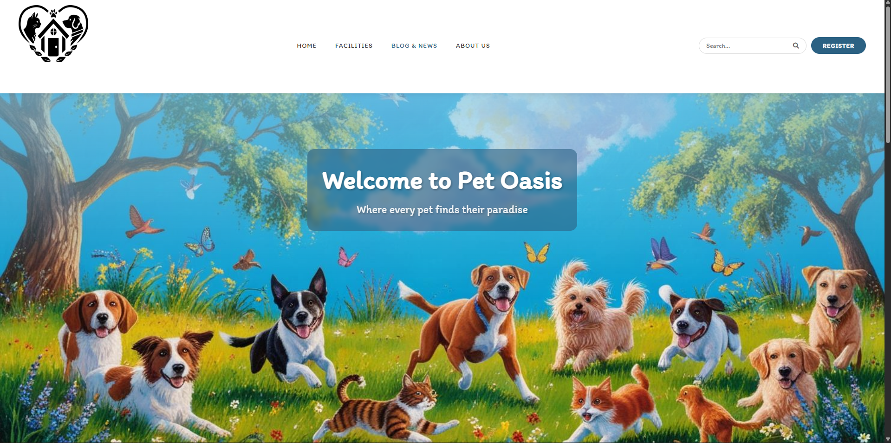

# Pet Oasis

> "Care for every paw, home for every heart"

Pet Oasis is a Django web application for a fictional chain of pet hotels and shelters. Visitors can browse the hotel locations, create an account, and register their pets; the site also has an about page and a blog/news page.



## Features

Derived from the models, views, URLs and templates in `PetOasis/`:

**Accounts** (`accounts`)
- Registration with username, email, first/last name and age; users under 18 are rejected, and the new user is logged in automatically.
- Login and logout.
- Profile page showing the user's picture and registered pets.
- Edit account: change username, email, profile picture and password (current password required).
- Delete account with password confirmation; the profile and the user's pets are deleted with it.
- Custom user model (`AppUser`, username-based login) with a one-to-one `Profile`.

**Pets** (`pets`)
- Logged-in users can register a pet: name, species (dog / cat / bird), optional breed, age, weight and optional photo.
- Delete a pet through a confirmation page. There is no edit view for pets.

**Facilities** (`facilities`)
- List of pet hotels (`PetHotel`: city, address, contact details, description, image URL) and a detail page per city.
- A `Shelter` model (dog / cat section per hotel) exists, but I could not find a view that lists it (verify).

**Home, Blog & News, About us**
- Home page shows the first three hotels and up to seven `PawPost` "customer feedback" cards.
- The Blog & News and About us pages appear to be static templates with hard-coded content (verify).

**Admin**
- Only the user model (with a profile inline) is registered in the Django admin. Hotels, shelters and paw posts have no admin registration yet, so they must be created from the shell (verify).

## Tech stack

- Python 3, Django 5.1
- PostgreSQL (via `psycopg2-binary`)
- Pillow for image uploads
- `python-dotenv` for configuration
- Django templates, Bootstrap 5.3 and custom CSS/JS in `PetOasis/static/`

## Run locally

Prerequisites: Python 3.10+ and a running PostgreSQL server with an empty database.

```bash
git clone https://github.com/HristiyanIliev06/Pet-Oasis.git
cd Pet-Oasis

python -m venv venv
# Windows: venv\Scripts\activate      macOS/Linux: source venv/bin/activate
pip install -r requirements.txt

cd PetOasis
cp .env.example .env          # then edit .env (see below)
python manage.py migrate
python manage.py createsuperuser
python manage.py runserver
```

Open http://127.0.0.1:8000/.

Configuration lives in `PetOasis/.env` (never committed). At minimum set:

| Variable | Purpose |
|---|---|
| `DJANGO_SECRET_KEY` | **Required.** Long random string. |
| `DB_PASSWORD` | Password of your PostgreSQL user. |
| `DB_NAME`, `DB_USER`, `DB_HOST`, `DB_PORT` | Only if they differ from the defaults (`pet_oasis_db`, `postgres`, `127.0.0.1`, `5432`). |
| `DJANGO_DEBUG` | Set to `True` for local development (default `False`). |
| `DJANGO_ALLOWED_HOSTS` | Comma-separated hosts (default `localhost,127.0.0.1`). |

Pages that list hotels need `PetHotel` rows; the admin does not expose them yet, so add some through `python manage.py shell` (verify).

## Tests

The suite uses an in-memory SQLite database, so no PostgreSQL privileges are needed:

```bash
cd PetOasis
# Windows PowerShell: $env:DJANGO_SECRET_KEY="test"; $env:DB_ENGINE="django.db.backends.sqlite3"; $env:DB_NAME=":memory:"
DJANGO_SECRET_KEY=test DB_ENGINE=django.db.backends.sqlite3 DB_NAME=:memory: python manage.py test
```

One test is marked `expectedFailure`: it documents a known bug in the hotel-name validator (`core/validators.py`), which rejects every name containing a space.

## Project structure

```
Pet-Oasis/
├── requirements.txt
└── PetOasis/                 # Django project root (manage.py lives here)
    ├── PetOasis/             # settings, root URLconf, wsgi/asgi
    ├── accounts/             # AppUser, Profile, auth + account views/forms
    ├── pets/                 # Pet model, register/delete views
    ├── facilities/           # PetHotel, Shelter, facility pages
    ├── blog_and_news/        # PawPost model, blog page
    ├── index/                # home page
    ├── about_us/             # about page
    ├── core/                 # shared validators
    ├── templates/            # project-wide HTML templates
    ├── static/               # CSS, JS, Bootstrap, images
    └── media/                # user uploads (git-ignored)
```

## Status and next steps

Work in progress, built as a learning/portfolio project.

- No booking flow: a `Booking` model was removed in an earlier migration, although the profile page still says pets are registered "for future booking".
- Profile page contains placeholder content ("Your Offers", "Your Discount Cards", sample pets) (verify).
- The `PawPost` create form/view is commented out; the Blog & News page is not driven by the database.
- Register `PetHotel`, `Shelter` and `PawPost` in the admin.
- Fix the hotel-name validator bug and add CI for the test suite.
- Replace the placeholder screenshot in `docs/home.png`.
